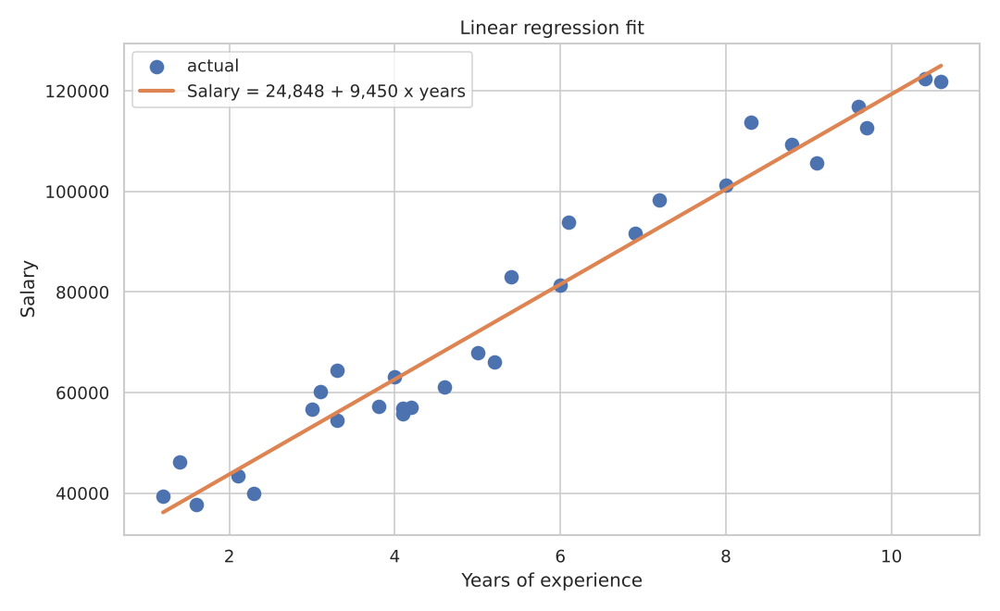
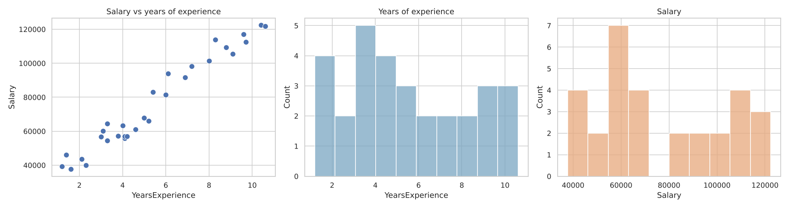
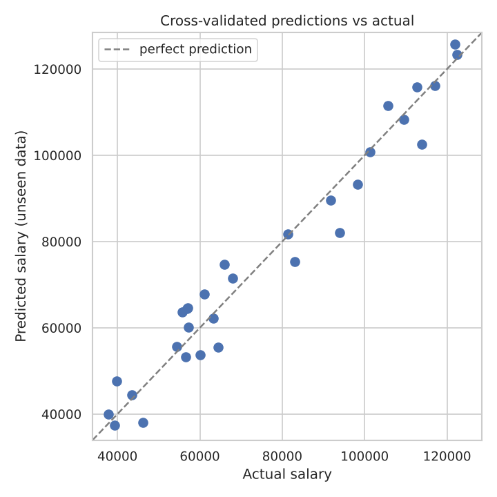
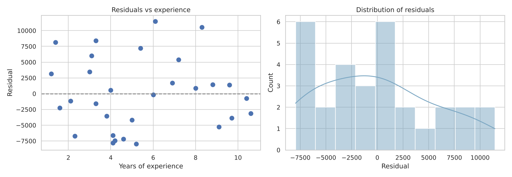

# Salary Prediction with Linear Regression

A machine learning project that predicts salary from years of experience. It covers the full workflow: exploring the data, training and validating the model, checking its assumptions, saving it and using it from the command line.




## Results

| | |
|---|---|
| **Model** | Simple linear regression (scikit-learn) |
| **Equation** | Salary ≈ 24,848 + 9,450 × years of experience |
| **Cross-validated R²** | 0.95: experience explains about 95% of the variation in salary |
| **Cross-validated MAE** | ≈ 4,700: predictions are typically within about 4,700 of the actual salary |

**In plain terms:** each extra year of experience adds about **9,450** to salary in this dataset.

## Overview

The [Salary Dataset](https://www.kaggle.com/datasets/abhishek14398/salary-dataset-simple-linear-regression) from Kaggle has 30 employees, each with years of experience and annual salary. The question is simple: *how well can experience alone predict pay?*

It started as a machine learning exercise during my data science training (2024), where I trained a model and saved it as a `.joblib` file. I later rebuilt the project around that model. I added the training code, proper validation, residual checks and a prediction script, and documented every step. The retrained model gives exactly the same coefficients as my original one.

## Walkthrough

The full analysis is in [`notebooks/salary_prediction.ipynb`](notebooks/salary_prediction.ipynb).

### 1. Explore the data
The data is clean, with no missing values or duplicates. A scatter plot shows a strong straight-line relationship (correlation 0.98), which makes linear regression a reasonable choice.



### 2. Validate before trusting
With only 30 rows, a single 80/20 split would test on just 6 people, so the score would depend on luck. **5-fold cross-validation** is used instead: every employee is predicted by a model that never saw them during training.



### 3. Train the final model
After validation, the final model is trained on all 30 rows.
- **Slope (9,450):** the salary increase for each additional year.
- **Intercept (24,848):** where the line starts. No one in the data has under 1.2 years of experience, so this isn't a real starting salary.

### 4. Check the assumptions
The residuals (actual minus predicted) scatter randomly around zero with no curve or funnel shape, which confirms that a straight line suits the data. The training R² (0.957) is almost the same as the cross-validated R² (0.954), so the model isn't overfitting.



### 5. Predict
| Years of experience | Predicted salary |
|---|---|
| 1.5 | 39,023 |
| 3 | 53,198 |
| 5 | 72,098 |
| 7.5 | 95,723 |
| 10 | 119,348 |

### Limitations
- **Small sample:** 30 people means real uncertainty in the estimates.
- **One feature:** role, location, education and industry also affect salary.
- **Extrapolation:** outside 1.2–10.6 years, the model assumes salaries keep rising in a straight line. The prediction script warns when you go outside that range.

## Project structure

```
salary-prediction-linear-regression/
├── data/
│   ├── salary_data.csv          # 30 employees
│   └── README.md
├── figures/                     # charts produced by the notebook
├── models/
│   └── salary_model.joblib      # trained model
├── notebooks/
│   └── salary_prediction.ipynb  # step-by-step walkthrough
├── src/
│   ├── train.py                 # validate, train and save the model
│   └── predict.py               # command-line predictions
├── requirements.txt
└── README.md
```

## Getting started

```bash
git clone https://github.com/FaithNjah/salary-prediction-linear-regression.git
cd salary-prediction-linear-regression
pip install -r requirements.txt
```

**Make predictions** with the trained model:
```bash
python src/predict.py 5
#   5.0 years ->     72,098

python src/predict.py 2 4.5 8
```

**Retrain** the model (prints the cross-validation scores and saves a new model):
```bash
python src/train.py
```

**Explore the walkthrough:**
```bash
jupyter notebook notebooks/salary_prediction.ipynb
```

## Skills demonstrated

- Supervised learning with **scikit-learn** (linear regression)
- Choosing a validation strategy that suits a small dataset (k-fold cross-validation)
- Regression metrics (R², MAE, RMSE) and interpreting coefficients
- Residual analysis to check model assumptions
- Saving and loading models with **joblib**
- Turning a notebook into reusable scripts with a command-line interface

## Author

**Faith Njah**: software developer with a background in Medical Physiology.

More projects: [Medical Students Data Preprocessing](https://github.com/FaithNjah/medical-students-data-preprocessing) · [Titanic Data Cleaning](https://github.com/FaithNjah/titanic-data-cleaning)
